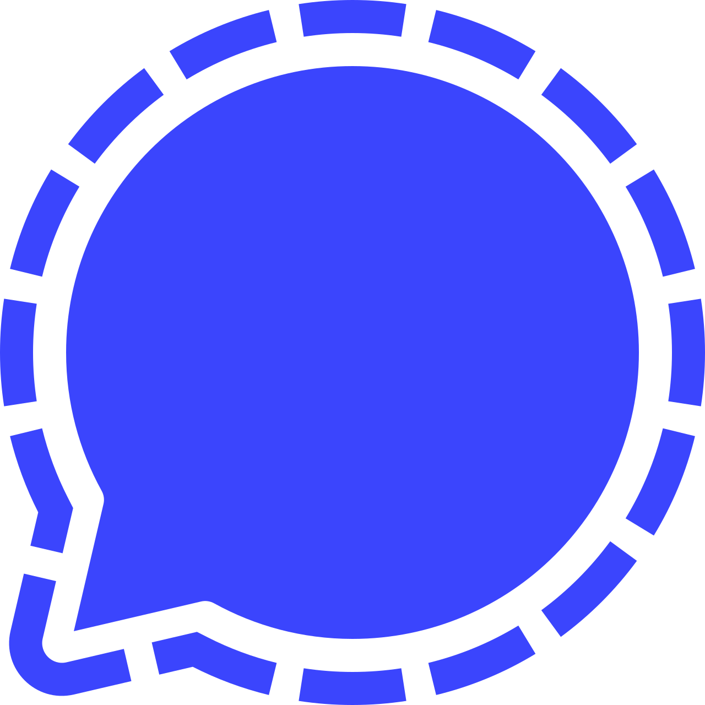
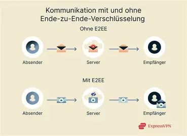
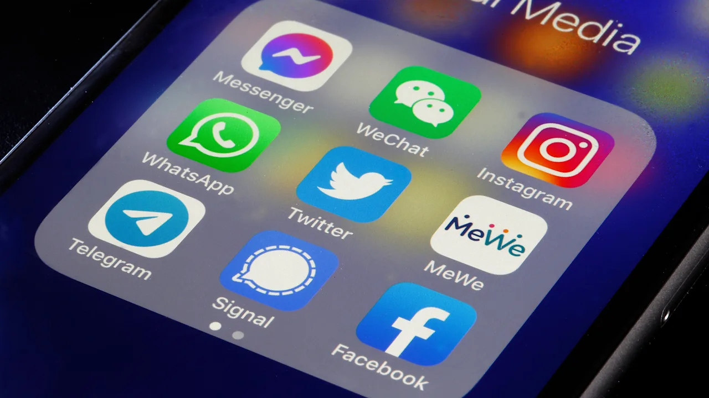

<!-- _class: cover -->

  
  
  

# Welcher Messengerdienst bietet den besten Schutz für meine privaten Daten?

---

<!-- _class: content-slide overview-slide -->

# Überblick über WhatsApp, Telegram und Signal

| Dienst | Ende-zu-Ende Verschlüsselung | Quellcode | Worin unterscheidet er sich? |
| --- | --- | --- | --- |
| WhatsApp | [Seit 2016 standardmäßig für alle Nachrichten und Anrufe](https://www.dr-datenschutz.de/die-ende-zu-ende-verschluesselung-bei-whatsapp/) | [Nicht Open Source](https://reset.org/messenger-open-source-und-ende-zu-ende-verschluesselt-das-sind-die-sicheren-alternativen-zu-whatsapp/) | Immer E2E-Verschlüsselung; Quellcode nicht einsehbar |
| Telegram | [Nicht standardmäßig, nur bei geheimen Chats](https://metricool.com/de/telegram-sicherheit-ein-check-deiner-kommunikation/#Ende-zu-Ende-Verschluesselung_bei_geheimen_Chats) | [Teilweise Open Source](https://telegram.org/apps) | Keine E2E-Verschlüsselung standardmäßig; nur Quellcode der Apps einsehbar |
| Signal | [Standardmäßig für Nachrichten, Anrufe und Gruppenchats](https://www.chip.de/ratgeber/software/datenschutz-und-sicherheit-bei-signal-das-muessen-sie-wissen_72abeec7-207c-4507-a1e9-5b4dff63f569.html) | [Open Source](https://www.chip.de/ratgeber/software/datenschutz-und-sicherheit-bei-signal-das-muessen-sie-wissen_72abeec7-207c-4507-a1e9-5b4dff63f569.html) | Immer E2E-Verschlüsselung; Quellcode für jeden einsehbar |
---
<!-- _class: content-slide e2e-slide -->

# 1. Kriterium: Ende-zu-Ende Verschlüsselung 

Bietet der Dienst standardmäßig Ende-zu-Ende-Verschlüsselung an und welche Nachrichten werden verschlüsselt?

---
<!-- _class: content-slide personal-data-slide -->

# 2. Kriterium: Umgang mit persönlichen Daten

Welche Daten werden über mich gesammelt, wie lange werden sie gespeichert und werden sie eventuell weiterverkauft?

---

<!-- _class: content-slide funding-slide -->

# 3. Kriterium: Finanzierung

Welchen Einfluss hat die Finanzierung auf meine Privatsphäre?

---
<!-- _class: content-slide -->

# Ausgewählter Dienst: Signal

1. **Ende-zu-Ende Verschlüsselung:**
- [Standardmäßig für alle Nachrichten, Anrufe und Gruppenchats](https://www.zwp-online.info/zwpnews/dental-news/branchenmeldungen/wie-sicher-ist-der-messenger-signal-wirklich)
- [Basierend auf dem Signal Protokoll](https://www.zwp-online.info/zwpnews/dental-news/branchenmeldungen/wie-sicher-ist-der-messenger-signal-wirklich)
- [Double Ratchet, d.h. Signal erneuert für jede versendete Nachricht den Schlüssel und alte Schlüssel werden gelöscht](https://www.bsi.bund.de/SharedDocs/Downloads/DE/BSI/Publikationen/DVS-Berichte/messenger.pdf?__blob=publicationFile&v=8)
- [Verschlüsselung lässt sich sogar nicht durch Quantencomputer knacken](https://www.heise.de/news/Signal-sichert-seine-Chats-gegen-Quantencomputer-10717838.html)

---
<!-- _class: content-slide -->

2. **Umgang mit persönlichen Daten:**
- Signal vertritt Zero-Knowledge-Policy, daher werden nur folgende [Metadaten](https://www.tagesschau.de/signal-messenger-sicherheit-usa-regierung-trump-100.html) bis zur Löschung der App gespeichert:
  - Datum- und Uhrzeit der Kontoerstellung
  - Tag der letzten Verbindung zum Signal Server
  - Telefonnummer
  - Kontaktdaten bei Einverständnis
- Temporäre Nachrichten werden gespeichert, solange sie nicht versendet werden können
- [Signal folgt den Vorgaben der Datenschutz-Vorgaben der DSVGO](https://www.datenschutz.org/signal/)

---
<!-- _class: content-slide -->

3. **Finanzierung:**
- Signal ist eine gemeinnützige Non Profit Stiftung ["Signal Technology Foundation"](https://projects.propublica.org/nonprofits/organizations/824506840)
  - Dies verhindert einen Aufkauf durch einen Tech-Giganten wie z.B. Meta oder eine Umwandlung in ein werbebasiertes Geschäftsmodell
- [Schaltet keine Werbung, nutzt keine Tracker, verkauft keine Nutzerdaten](https://www.chip.de/news/Nach-Pannen-in-den-USA-Das-muessen-Signal-Nutzer-jetzt-wissen_185891159.html)
- Finanziert sich durch frewillige Spenden z.B. [durch einmalige Spenden oder das Spendenabo in der App](https://aboutsignal.com/de/news/neues-design-fur-die-einmaligen-spendenabzeichen-von-signal/)
- [Bietet kostenpflichtige Zusatzfunktionen an z.B. Cloudbackups](https://www.golem.de/news/messenger-app-signal-erhaelt-cloud-back-up-abo-startet-2509-199902.html)

---

<!-- _class: content-slide -->

# Fazit

Ich persönlich würde mich für die Nutzung des Messengers Signal entscheiden, da er meiner Meinung nach durch das Signal Protokoll die beste Verschlüsselung meiner Nachrichten bietet. Ausserdem gefällt mir, dass Signal nur sehr wenige Metadaten speichert so können meine Daten nicht durch Datenleckes in die falschen Hände geraten. Auch finde ich gut, dass es sich bei Signal um eine gemeinnützige Stiftung handelt, die anders als z.B. WhatsApp keinen Gewinn erzielen muss und daher nicht auf Werbung zurück greift oder meine Nutzerdaten verkauft.

Daher bietet der Signal Messenger den besten Schutz für meine privaten Daten!

---

<!-- _class: content-slide sources-slide -->

# Quellen

- WhatsApp: [Ende-zu-Ende-Verschlüsselung](https://www.dr-datenschutz.de/die-ende-zu-ende-verschluesselung-bei-whatsapp/), abgerufen am 6.10.2026 15:07; [Quellcode](https://reset.org/messenger-open-source-und-ende-zu-ende-verschluesselt-das-sind-die-sicheren-alternativen-zu-whatsapp/), abgerufen am 6.10.2026 15:27
- Telegram: [Verschlüsselung bei geheimen Chats](https://metricool.com/de/telegram-sicherheit-ein-check-deiner-kommunikation/#Ende-zu-Ende-Verschluesselung_bei_geheimen_Chats), abgerufen am 6.10.2026 15:14; [Apps/Quellcode](https://telegram.org/apps), abgerufen am 6.10.2026 15:24
- Signal: [Datenschutz & Sicherheit](https://www.chip.de/ratgeber/software/datenschutz-und-sicherheit-bei-signal-das-muessen-sie-wissen_72abeec7-207c-4507-a1e9-5b4dff63f569.html), abgerufen am 6.10.2026 15:20; [Signal-Check](https://www.zwp-online.info/zwpnews/dental-news/branchenmeldungen/wie-sicher-ist-der-messenger-signal-wirklich), abgerufen am 7.10.2026 15:17; [Datenspeicherung & Finanzierung](https://www.datenschutz.org/signal/), abgerufen am 7.10.2026 15:24
- Fachbegriffe: [DSGVO](https://www.dataproofed.de/dsgvo-einfach-erklaert-datenschutzgrundverordnung/), abgerufen am 11.10.2026 14:02; [Metadaten](https://www.ibm.com/de-de/think/topics/metadata), abgerufen am 11.10.2026 14:08; [Ende-zu-Ende-Verschlüsselung](https://eperi.com/de/docs/ende-zu-ende-verschlusselung/), abgerufen am 11.10.2026 14:19; [Signal Protokoll](https://www.heise.de/select/ct/2021/9/2031014491848172917), abgerufen am 12.10.2026 11:16; [Open Source](https://www.iese.fraunhofer.de/blog/open-source-software/), abgerufen am 12.10.2026 16:10; [Gemeinnützige Stiftung](https://www.deutsches-stiftungszentrum.de/stiftungswissen/stiftungsformen/gemeinnuetzige-stiftung), abgerufen am 12.10.2026 11:23
- Sicherheitsbelege: [Quantencomputer-Schutz](https://www.heise.de/news/Signal-sichert-seine-Chats-gegen-Quantencomputer-10717838.html), abgerufen am 19.10.2026 13:54; [BSI DVS-Bericht](https://www.bsi.bund.de/SharedDocs/Downloads/DE/BSI/Publikationen/DVS-Berichte/messenger.pdf?__blob=publicationFile&v=8), abgerufen am 19.10.2026 13:55; [Metadaten/Tagesschau](https://www.tagesschau.de/signal-messenger-sicherheit-usa-regierung-trump-100.html), abgerufen am 19.10.2026 13:58; [Cloud-Backups](https://www.golem.de/news/messenger-app-signal-erhaelt-cloud-back-up-abo-startet-2509-199902.html), abgerufen am 19.10.2026 13:59
- Finanzierung & Datenschutz: [Signal Technology Foundation](https://projects.propublica.org/nonprofits/organizations/824506840), abgerufen am 21.10.2026 13:43; [Keine Werbung, keine Tracker, keine Nutzerdatenverkauf](https://www.chip.de/news/Nach-Pannen-in-den-USA-Das-muessen-Signal-Nutzer-jetzt-wissen_185891159.html), abgerufen am 21.10.2026 13:47; [Spendenabzeichen](https://aboutsignal.com/de/news/neues-design-fur-die-einmaligen-spendenabzeichen-von-signal/), abgerufen am 21.10.2026 13:51
- Bildquellen: [E2E-Illustration](https://www.expressvpn.com/de/blog/ende-zu-ende-verschlusselung/), abgerufen am 16.10.2026 16:44; [Geldsymbol](https://www.hartvannederland.nl/advies-en-tips/kopen-besparen/artikelen/banken-gaan-minder-vragen-stellen-bij-gebruik-van-contant-geld), abgerufen am 16.10.2026 16:45; [Datenschutzsymbol](https://www.bild.de/digital/internet/internet/werbung-mit-persoenlichen-daten-signal-zeigt-was-facebook-ueber-uns-weiss-76291690.bild.html), abgerufen am 16.10.2026 16:46
